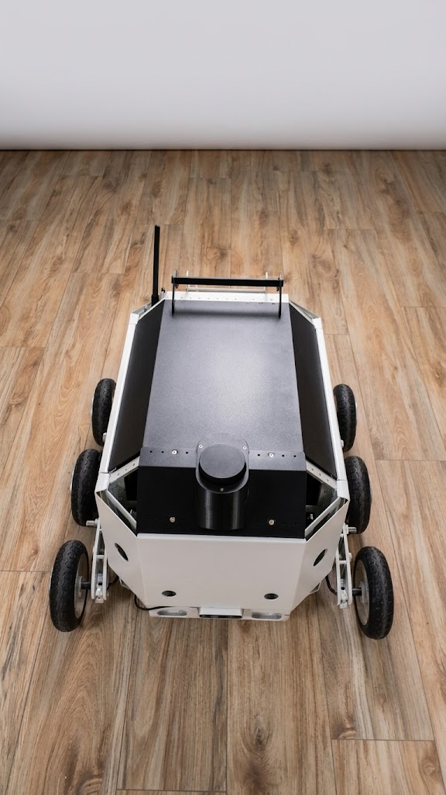
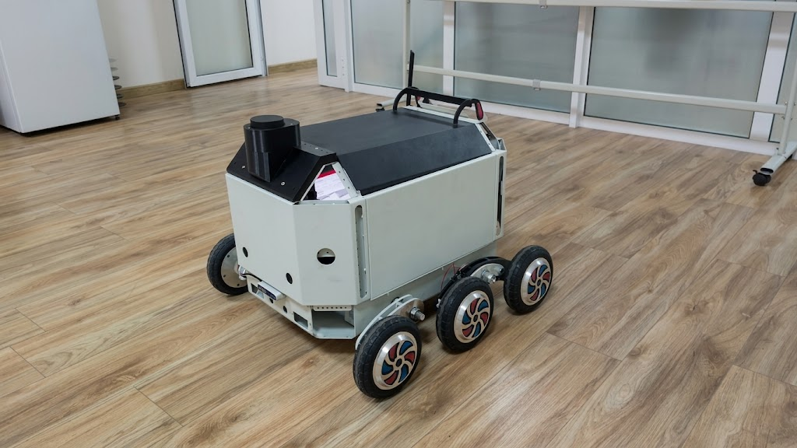
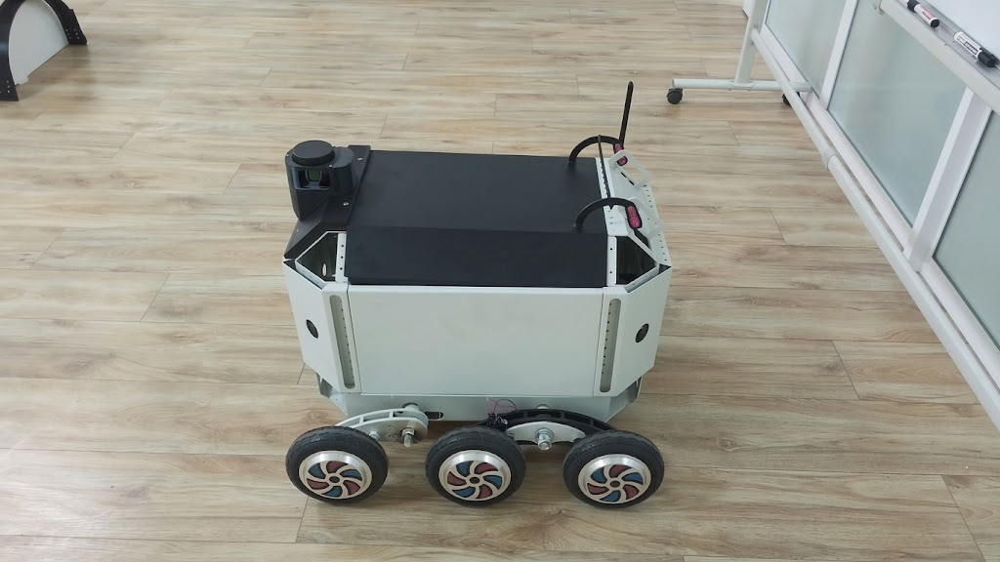
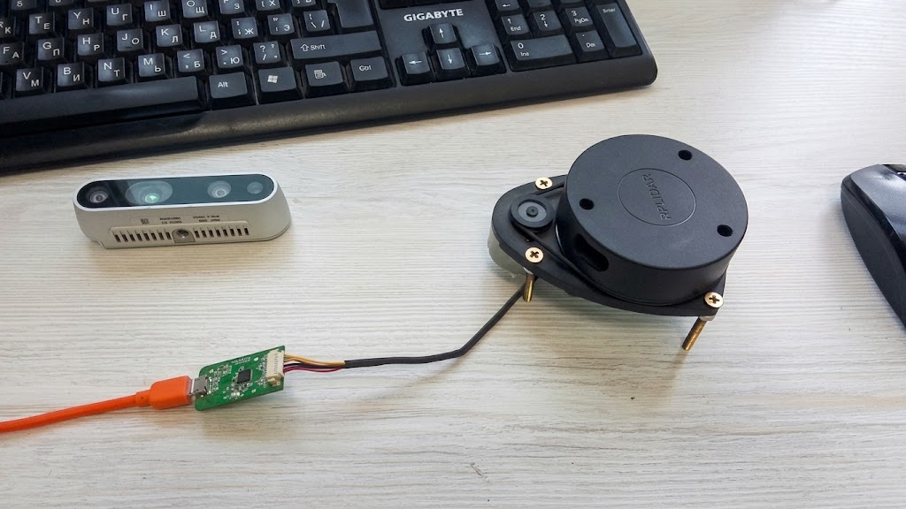

# RoVer-autonomous-logistics
Autonomous Mobile Robot for Industrial and Warehouse Logistics
# Rover6 — Autonomous Mobile Robot for Industrial Logistics

  

  <b>Autonomous Mobile Robot for Industrial and Warehouse Logistics</b>

**Rover6** is an autonomous mobile robotic platform developed in Uzbekistan for industrial, warehouse and facility logistics.

The project is designed to automate repetitive cargo transportation between predefined locations in factories, warehouses, logistics centers and industrial campuses.

## 🎬 Rover6 in Motion

https://github.com/user-attachments/assets/35bc0364-f688-46a4-8c9d-c0f6164b4cb8

*Development prototype · 6 seconds.* Rover6 drives away from the camera during an outdoor test on asphalt.

[View all prototype demonstrations](docs/demonstrations.md).

---

## 🚀 Project Status

Rover6 is currently at the **working MVP stage**.

The robot is physically assembled and capable of autonomous navigation between points after initial mapping of the operating environment.

Current capabilities include:

- Autonomous mapping and localization
- Autonomous point-to-point navigation
- Route planning
- Wheel odometry
- LiDAR-based environment perception
- Depth-camera perception
- IMU-based motion data
- ROS 2 integration
- Emergency Stop system
- On-board computing
- Independent left/right drivetrain control

---

## 🤖 Hardware Platform

Rover6 is based on a six-wheel mobile robotic platform.
## 📸 Rover6 Platform

  
  

  
  

See the [workshop hardware overview](docs/demonstrations.md#hardware-overview) for a closer look at the open-body development prototype and six-wheel chassis.

Main components include:

- 6-wheel electric drivetrain
- Wheel encoders
- ESP32-S3 low-level controller
- On-board high-performance computer
- RPLIDAR
- Intel RealSense depth camera
- 9-axis IMU
- Motor drivers
- Battery-powered architecture
- Emergency Stop system

Current platform weight is approximately **50 kg**.

The mechanical architecture is designed for further testing with payloads exceeding **100 kg**.

---

## 🧪 Field Testing

### Curb Traversal

https://github.com/user-attachments/assets/64afe0c8-857d-4f76-8a03-fc134440ae34

*Development prototype · 21 seconds.* The rover crosses a low concrete curb from asphalt to soil, showing the six-wheel chassis adapting to the height change.

Explore the [complete demonstration gallery](docs/demonstrations.md) for additional workshop, driving and load demonstrations.

---

## 🧠 Software Architecture

The autonomous navigation stack is based on:

- Ubuntu Linux
- ROS 2
- SLAM
- Localization
- Navigation and path planning
- Sensor integration
- Wheel odometry
- LiDAR processing
- Depth-camera data
- IMU data
- ESP32 motor-control interface

High-level architecture:

Sensor Data  
↓  
Localization & Mapping  
↓  
Route Planning  
↓  
Autonomous Navigation  
↓  
Velocity Commands  
↓  
ESP32-S3  
↓  
Motor Drivers  
↓  
6-Wheel Drivetrain

---

## 🗺 Autonomous Navigation

During the initial deployment, Rover6 maps its operating environment.

After the map is created, the robot can localize itself and autonomously navigate between specified points without continuous human control.

This makes Rover6 suitable for repetitive logistics operations in structured industrial environments.

---

## 🏭 Target Applications

Rover6 is being developed for:

- Manufacturing facilities
- Warehouses
- Logistics centers
- Industrial campuses
- Internal cargo transportation
- Material movement between production areas
- Autonomous delivery within controlled facilities

---

## 🎯 Project Goal

The goal of Rover6 is to reduce the cost and human workload associated with repetitive internal logistics operations.

The platform is being developed as a locally engineered autonomous logistics solution for Uzbekistan with future expansion potential across Central Asia.

---

## 📌 Development Stage

**Stage:** MVP

The main hardware and software systems have been integrated and autonomous navigation is operational.

Current development focus:

- Reliability testing
- Payload testing
- Obstacle-handling validation
- Industrial pilot preparation
- Commercialization

Watch the [prototype load demonstration](docs/demonstrations.md#load-demonstration) and [driving and maneuvering test](docs/demonstrations.md#driving-and-maneuvering).

---

## 🇺🇿 Developed in Uzbekistan

Rover6 is designed and developed in Uzbekistan as an autonomous robotics platform for industrial logistics.

---

## 🔒 Repository Notice

This public repository contains selected project information and demonstration materials.

Some production source code, hardware configurations and proprietary components are intentionally not published.
